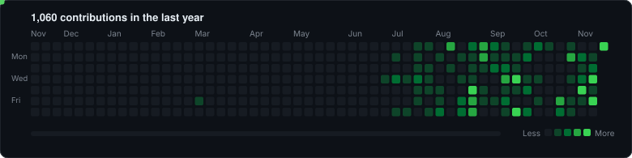

### 👋 Olá, eu sou o Dyego Santos

Desenvolvedor de software em **Recife, PE**. Atuo no desenvolvimento de aplicações web, portais corporativos, rotinas de automação e integrações com sistemas de gestão (ERP/TOTVS, bancos de dados e diretórios de rede).

🔗 **[Portfólio](https://dyego-portfolio-ten.vercel.app/)** · 📄 **[Currículo (PDF)](https://dyego-portfolio-ten.vercel.app/curriculo-dyego-santos-melhorado.pdf)** · 💼 **[LinkedIn](https://www.linkedin.com/in/dyego-santos-1bb26210b/)** · ✉️ **[dyegosan14@gmail.com](mailto:dyegosan14@gmail.com)**

---

### 📊 Atividade & Linguagens

  

  

---

### 🚀 Projetos Públicos

- **[HelpDesk-Pro](https://github.com/dyegosan14-tech/HelpDesk-Pro)** — Sistema de chamados de TI (ITSM) com controle de SLA, perfis de acesso (RBAC), base de conhecimento, avaliação de atendimento e exportação de relatórios. `React` `Node.js` `SQLite`
- **[bairro-alerta](https://github.com/dyegosan14-tech/bairro-alerta)** — Plataforma de zeladoria urbana com consultas geoespaciais em PostGIS, API em Fastify documentada com Swagger e trilha de auditoria. `TypeScript` `Fastify` `PostGIS` `Docker`
- **[analista-dados-ia](https://github.com/dyegosan14-tech/analista-dados-ia)** — Consulta a banco de dados em linguagem natural (Text-to-SQL com validação de leitura), geração de gráficos e relatórios. `TypeScript` `Express` `SQLite`
- **[ia-dados-avancados](https://github.com/dyegosan14-tech/ia-dados-avancados)** — Ferramentas em Python e DuckDB para busca semântica, previsão de demanda e geração de relatórios. `Python` `DuckDB`
- **[SchemaWatch](https://github.com/dyegosan14-tech/SchemaWatch)** — Verificação de integridade, padronização e conformidade de esquemas em bancos de dados. `TypeScript` `SQL`
- **[agua-em-rede](https://github.com/dyegosan14-tech/agua-em-rede)** — Painel para acompanhamento de pressão, vazão e controle de perdas na rede de distribuição de água. `TypeScript` `Node.js`

---

### 🛠️ Tecnologias de Uso Diário

- **Backend & Dados:** TypeScript, Node.js (Express, Fastify), Python, SQL Server, PostgreSQL / PostGIS, SQLite
- **Frontend:** React, Next.js, Vite, HTML/CSS, Tailwind CSS
- **Infraestrutura & Integrações:** Docker, Linux, GitHub Actions, SFTP, Active Directory / LDAP, TOTVS RM
