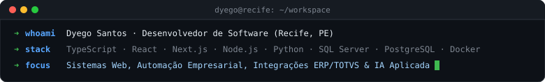

### 👋 Olá, eu sou o Dyego Santos

Desenvolvedor de software em **Recife, PE**. Trabalho no desenvolvimento de aplicações web, portais internos, rotinas de automação e integração com sistemas corporativos (ERP/TOTVS, bancos de dados e diretórios de rede).

🔗 **[Portfólio](https://dyego-portfolio-ten.vercel.app/)** · 📄 **[Currículo (PDF)](https://dyego-portfolio-ten.vercel.app/curriculo-dyego-santos-melhorado.pdf)** · 💼 **[LinkedIn](https://www.linkedin.com/in/dyego-santos-1bb26210b/)** · ✉️ **[dyegosan14@gmail.com](mailto:dyegosan14@gmail.com)**

  

  

  

---

### 🛠️ Stack & Ferramentas

  
  
  
  
  
  
  
  
  
  
  
  
  
  
  

---

### 🚀 Projetos Públicos em Destaque

| Repositório | Escopo Técnico | Stack |
| :--- | :--- | :--- |
| **[HelpDesk-Pro](https://github.com/dyegosan14-tech/HelpDesk-Pro)** | Sistema de chamados de TI (ITSM) com controle de SLA, RBAC, base de conhecimento, CSAT, MTTR e auditoria. | `React` `Node.js` `SQLite` |
| **[bairro-alerta](https://github.com/dyegosan14-tech/bairro-alerta)** | Plataforma de zeladoria urbana com consultas geoespaciais em PostGIS, API tipada em Fastify (Swagger) e auditoria. | `TypeScript` `Fastify` `PostGIS` |
| **[analista-dados-ia](https://github.com/dyegosan14-tech/analista-dados-ia)** | Agente para consulta a banco de dados em linguagem natural (*Text-to-SQL* seguro), gráficos e relatórios. | `TypeScript` `Express` `SQLite` |
| **[ia-dados-avancados](https://github.com/dyegosan14-tech/ia-dados-avancados)** | Avaliador de modelos (*LLM-as-a-Judge*), busca semântica com reranker e relatórios autônomos em DuckDB. | `Python` `DuckDB` `LLM` |
| **[diario360-jornal-digital](https://github.com/dyegosan14-tech/diario360-jornal-digital)** | Portal de notícias e indicadores econômicos com visualização de pesquisas, sparklines e modo de leitura executivo. | `React` `TypeScript` `Tailwind` |
| **[SchemaWatch](https://github.com/dyegosan14-tech/SchemaWatch)** | Monitoramento de integridade, padronização e conformidade de esquemas em bancos de dados. | `TypeScript` `SQL` |

---

### 🎓 Certificações & Formação Técnica

<strong>Ver todas as 16 certificações verificadas (TOTVS Educação, FIAP + Alura, EBAC, DIO)</strong>

 

- **TOTVS Educação (Linha RM & Tecnologia)**
  - [Consulta SQL — Linha RM (2026)](https://educacao.totvs.com/#/certificate-authenticity/eyJpZEVucm9sbG1lbnQiOjE0MTc3NTg1fQ==) · [Inteligência Artificial (2025)](https://educacao.totvs.com/#/certificate-authenticity/eyJpZEVucm9sbG1lbnQiOjk4MjUyNDR9) · [Introduction to Progress OpenEdge 12 (2025)](https://educacao.totvs.com/#/certificate-authenticity/eyJpZEVucm9sbG1lbnQiOjgxNTU0Mzl9)
  - [Gestão de Compras e Suprimentos — Linha RM](https://educacao.totvs.com/#/certificate-authenticity/eyJpZEVucm9sbG1lbnQiOjgyNDkzMzd9) · [Gestão Financeira — Linha RM](https://educacao.totvs.com/#/certificate-authenticity/eyJpZEVucm9sbG1lbnQiOjY1NTMyNn0=) · [Contas a Pagar](https://educacao.totvs.com/#/certificate-authenticity/eyJpZEVucm9sbG1lbnQiOjgyNDkzNjh9) · [Contas a Receber](https://educacao.totvs.com/#/certificate-authenticity/eyJpZEVucm9sbG1lbnQiOjY1NjE5NH0=) · [Gestão Patrimonial](https://educacao.totvs.com/#/certificate-authenticity/eyJpZEVucm9sbG1lbnQiOjY1NjIwNH0=)
- **Alura + FIAP & DIO**
  - [Agentic Engineering: Orquestração de Agentes de IA (Alura + FIAP, 2026)](https://www.linkedin.com/feed/update/urn:li:activity:7513731862129782784/)
  - [Introdução a Banco de Dados Relacionais (DIO, 2026)](https://www.dio.me/certificate/ID1ZMSD1/share) · [Princípios do Git e GitHub (DIO, 2026)](https://www.dio.me/certificate/DI8VCQOK/share)
- **EBAC & Safetec**
  - [Dados na Prática: Análise de Negócio com IA (EBAC, 2026)](https://www.linkedin.com/feed/update/urn:li:activity:7518134094644457472/) · [QA na Era da IA: Testes de Software na Prática (EBAC, 2026)](https://www.linkedin.com/feed/update/urn:li:activity:7516671856255623168/) · [Cybersegurança na Era da IA (EBAC, 2026)](https://www.linkedin.com/feed/update/urn:li:activity:7509352634244505600/)

