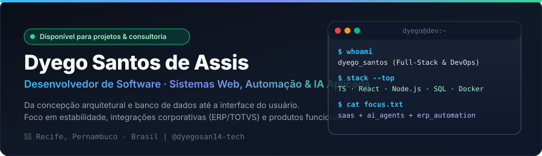
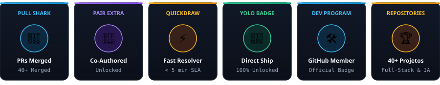
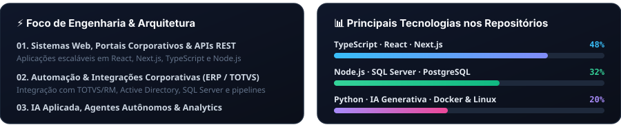

  

   

  
  
  
  

---

### 🏆 Troféus & Conquistas no GitHub

  

---

### ⚡ Visão Geral & Especialidades

  

---

### 🛠️ Stack Tecnológica & Ferramentas

**Linguagens & Backend**

  
  
  
  
  
  

**Frontend & Interface**

  
  
  
  
  

**Banco de Dados, Infraestrutura & IA**

  
  
  
  
  
  
  
  

---

### 🚀 Projetos Públicos em Destaque

| Projeto | Descrição | Stack Principal |
| :--- | :--- | :--- |
| **[🤖 Analista de Dados IA](https://github.com/dyegosan14-tech/analista-dados-ia)** | Agente de IA para análise de dados (*Text-to-SQL* seguro), gerando gráficos e relatórios automáticos. | `TypeScript` · `Express` · `SQLite` · `Claude AI` |
| **[🎫 HelpDesk Pro](https://github.com/dyegosan14-tech/HelpDesk-Pro)** | Sistema corporativo de suporte e gestão de chamados de TI (ITSM) com SLA, RBAC, CSAT, MTTR e auditoria. | `React` · `Node.js` · `SQLite` · `RBAC` |
| **[🧠 IA & Dados Avançados](https://github.com/dyegosan14-tech/ia-dados-avancados)** | Avaliador de Chatbots (*LLM-as-a-Judge*), Busca Semântica com Reranker e Agente Autônomo em DuckDB. | `Python` · `DuckDB` · `LLM` · `RAG` |
| **[📍 Bairro Alerta](https://github.com/dyegosan14-tech/bairro-alerta)** | Plataforma colaborativa de zeladoria urbana com inteligência geoespacial (PostGIS), métricas e auditoria. | `Fastify` · `TypeScript` · `React` · `PostGIS` |
| **[📰 Diário360](https://github.com/dyegosan14-tech/diario360-jornal-digital)** | Plataforma de jornal digital moderno com foco executivo, indicadores econômicos e ticker com sparklines. | `React` · `TypeScript` · `Tailwind CSS` |
| **[🛡️ SchemaWatch](https://github.com/dyegosan14-tech/SchemaWatch)** | Monitoramento de saúde, integridade e conformidade de bancos de dados corporativos. | `TypeScript` · `SQL` · `Compliance` |
